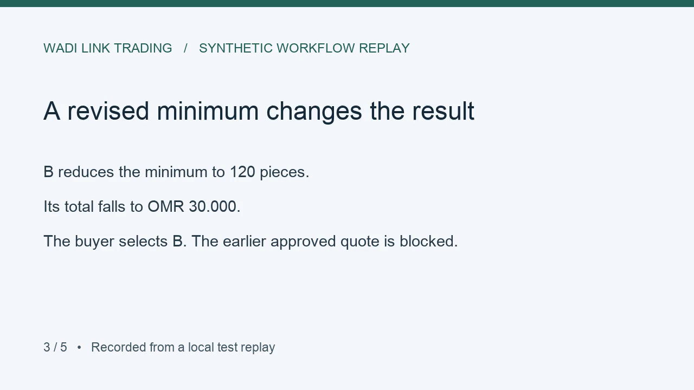

# Enquiry to Quotation

A freelance portfolio project for a fictional B2B trading company. Turn a customer enquiry into a reviewed quotation backed by supplier offers.

**Customer email → reviewed requirement → supplier RFQs → defensible customer quotation.**

[**Explore the public demo**](https://asaduddin18.github.io/enquiry-to-quotation/) · [Case study](artifacts/phase-8/case-study.md) · [Client pilot scope](docs/client-pilot.md) · [Roadmap](artifacts/phase-wise-plan.md)



## The problem

A trading company must compare supplier offers that use different pack sizes and minimum quantities, then stand behind the selling price and delivery terms it gives its customer. A revision can invalidate an approved quote while someone is preparing to send it.

## What this project demonstrates

- Python and FastAPI import saved EML and PDF files. DeepSeek proposes requirements with source evidence, and the buyer confirms them line by line.
- The buyer approves supplier recipients and generates a draft RFQ and Excel reply form. PostgreSQL keeps the approved files and requirement versions.
- Supplier workbooks link by reference and sender. Decimal arithmetic compares delivered spend including pack sizes and minimum quantities.
- Historical pricing compares verified purchases with the same specification and commercial basis. The buyer can open the evidence behind the median.
- Staff approve the exact quotation PDF and email draft. The app rechecks supplier terms before release and records manual issuance and actual purchase evidence separately.

## Evidence and limits

| Check | Observed result |
|---|---|
| PostgreSQL suite | 17 passed with pgvector. Three opt-in model checks ran separately. |
| Recorded replay | Revised MOQ reduced supplier B's delivered cost from OMR 50.000 to OMR 30.000. The old approved quote was blocked and the new quote totalled OMR 37.560. |
| Live model rerun | One of three cases cleared the full extraction and evidence check. Buyer review remains part of the workflow. |

The website is a static replay of fictional fixtures. The local app supports saved-file intake and manual sending. Live Gmail delivery, n8n execution, and production approval permissions remain unverified. [Final verification report](artifacts/phase-8/implementation-and-learning.md) · [Original project inspiration](https://github.com/Asaduddin18/ai-freelance-playbook/tree/main/projects/02-enquiry-quotation)

## Run the local app

Use Python 3.12 and a local PostgreSQL database. Install dependencies into a virtual environment, then set `DATABASE_URL` and `DEEPSEEK_API_KEY` locally. `DEEPSEEK_MODEL` is optional.

```sh
python3.12 -m venv .venv
.venv/bin/pip install -r requirements.txt
set -a
source .env
set +a
.venv/bin/uvicorn enquiry.app:app
```

Open http://127.0.0.1:8000 and upload the shutdown case's `01-customer-enquiry.eml`. Use `.venv/bin/python -m pytest` for the tests. Set `DATABASE_URL` to a disposable database to include PostgreSQL integration tests. Enable pgvector in that database to exercise vector retrieval.

- [Phase 3 implementation plan](artifacts/phase-3-implementation-plan.md)
- [Phase 3.1 implementation and learning report](artifacts/phase-3-1-implementation-and-learning.md)

[Phase 3.2 implementation and learning report](artifacts/phase-3-2-implementation-and-learning.md)

[Phase 3.3 implementation and learning report](artifacts/phase-3-3-implementation-and-learning.md)

[Phase 3.4 implementation and learning report](artifacts/phase-3-4-implementation-and-learning.md)

[Phase 4 implementation and learning report](artifacts/phase-4/implementation-and-learning.md)

[Phase 5 implementation and learning report](artifacts/phase-5/implementation-and-learning.md)

[Phase 6 evaluation and learning report](artifacts/phase-6/implementation-and-learning.md)

[Phase 7 historical pricing evaluation and learning report](artifacts/phase-7/implementation-and-learning.md)

Built by [Asaduddin18](https://github.com/Asaduddin18). Public for portfolio inspection. No open-source license has been selected.
